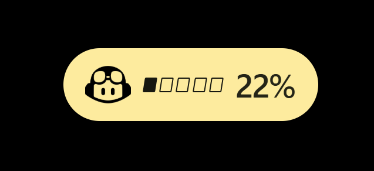

<div align="center">

# GCT

### GitHub Copilot Tracker

A lightweight Windows widget for GitHub Copilot AI-credit and Claude Code usage.

[Download the latest Windows release](https://github.com/Alexis-Fiolleau-LaPoste-BGPN/github-copilot-tracker/releases/latest) · [Showcase](https://alexis-fiolleau-laposte-bgpn.github.io/github-copilot-tracker/) · [Source](https://github.com/Alexis-Fiolleau-LaPoste-BGPN/github-copilot-tracker)

[](https://github.com/Alexis-Fiolleau-LaPoste-BGPN/github-copilot-tracker/releases/latest)
[](LICENSE)

</div>

<p align="center">
  
</p>

<p align="center"><em>Fresh capture of the running GCT pill. It showed 22% when captured; the live percentage varies with usage.</em></p>

## What it does

GCT keeps a compact, movable pill on your Windows desktop so you can check GitHub Copilot AI-credit usage or Claude Code usage without opening a dashboard. It can also show an approximate euro value for Copilot credits; this is an estimate, not a billing statement.

## Download and run

Download the latest Windows release from [Releases](https://github.com/Alexis-Fiolleau-LaPoste-BGPN/github-copilot-tracker/releases/latest). The Windows ZIP contains `gct.exe` and `WebView2Loader.dll`; extract both to the same folder and run `gct.exe`.

Requirements: Windows 11 and the Microsoft [WebView2 Runtime](https://developer.microsoft.com/microsoft-edge/webview2/). Current Windows installations usually include it.

Open Details from the pill to connect GitHub Copilot, or sign in to Claude Code on the same machine and select Claude in the tray menu.

## Features

- Floating pill with a segmented usage meter; drag it anywhere, resize it, pin it, or hide it to the system tray.
- GitHub Copilot AI-credit totals and an estimated euro equivalent. The estimate values each credit at GitHub's published $0.01 rate and uses a daily USD/EUR reference rate.
- Claude Code usage from the existing Claude Code login on the machine.
- Tray controls for source selection, refresh, usage details, start-at-login, and quitting.
- Configurable automatic refresh intervals.

## Privacy and credentials

The Copilot token is stored in the app's local WebView storage. GCT does not encrypt it itself. Use a token you are comfortable storing on this device, and remove it with **Change Token** before handing the device to someone else.

Claude usage uses the credentials maintained by Claude Code; GCT does not sign in to Claude separately.

## Build from source on Windows

Requirements: Node.js 20+, Rust stable, and MSYS2 installed under `%LOCALAPPDATA%\Programs\MSYS2` with MINGW64 GCC and binutils.

From PowerShell at the repository root, run:

```powershell
.\scripts\build-windows.ps1
```

The build produces `src-tauri\target\x86_64-pc-windows-gnu\release\gct.exe` and `WebView2Loader.dll`. Keep both files together when running or redistributing a local build.

## Links

- [Showcase page](https://alexis-fiolleau-laposte-bgpn.github.io/github-copilot-tracker/)
- [Releases](https://github.com/Alexis-Fiolleau-LaPoste-BGPN/github-copilot-tracker/releases)
- [Report a problem](https://github.com/Alexis-Fiolleau-LaPoste-BGPN/github-copilot-tracker/issues)

## License

MIT. See [LICENSE](LICENSE).
